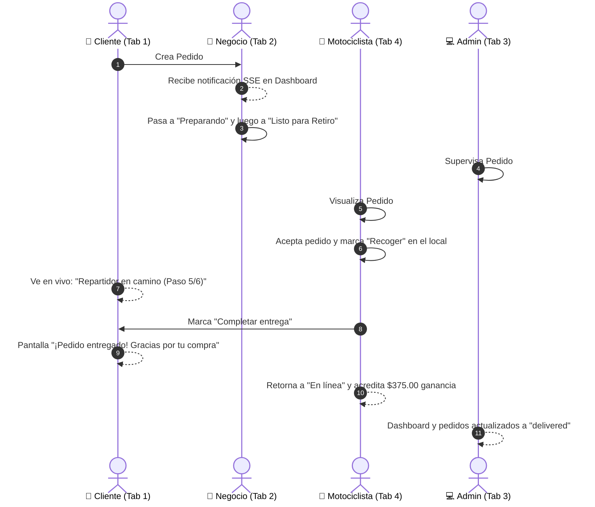

# Reporte de Verificación de Flujo Completo en 4 Navegadores Simultáneos

> **Fecha:** 2026-11-07  
> **Alcance:** Prueba de integración concurrente E2E ejecutando el ciclo de vida real de un pedido a través de 4 sesiones de navegador aisladas e independientes.  
> **Resultado:** ✅ Éxito Total (100% verificado sin errores ni descuadres contables).  

---

## 🧭 Arquitectura de la Prueba Concurrente

Se abrieron y orquestaron 4 pestañas simultáneas en Playwright con contextos de navegador completamente aislados (`isolatedContext`), asegurando que las cookies de sesión, tokens JWT y estados locales no se mezclaran:

---

## 📸 Evidencia de Capturas por Rol

Todas las capturas de alta resolución fueron almacenadas en la carpeta `app/test-flow-screenshots/`:

| Paso | Archivo | Rol | Descripción |
| :---: | :--- | :---: | :--- |
| **01** | `01-admin-dashboard-initial.png` | Admin | Panel de control inicial con KPIs consolidados |
| **02** | `02-commerce-dashboard-initial.png` | Negocio | Panel inicial de La Esquina del Sabor |
| **03** | `03-driver-home-initial.png` | Motociclista | Vista inicial del repartidor Juan Motociclista |
| **04** | `04-customer-home-initial.png` | Cliente | Catálogo público y bienvenida al cliente |
| **05** | `05-customer-checkout-ready.png` | Cliente | Carrito con Milanesa con papas fritas y checkout listo |
| **06** | `06-customer-order-created.png` | Cliente | **Pedido #38 Confirmado** en la plataforma |
| **07** | `07-customer-tracking-received.png` | Cliente | Seguimiento en tiempo real del pedido recién recibido |
| **08** | `08-commerce-dashboard-order-38.png` | Negocio | Notificación reactiva del Pedido #38 en Dashboard |
| **09** | `09-commerce-orders-preparing.png` | Negocio | Preparación y botón "Listo para Retiro" |
| **10** | `10-admin-orders-list-38.png` | Admin | Pedido #38 visible en la lista administrativa |
| **11** | `11-admin-order-modal-details.png` | Admin | Modal de auditoría profunda del Pedido #38 |
| **12** | `12-driver-order-available.png` | Motociclista | Pedido #38 visible en la lista "Cerca de ti" |
| **13** | `13-driver-order-ready-to-pickup.png` | Motociclista | Chofer asignado con botón "Recoger en local" |
| **14** | `14-driver-order-picked-up.png` | Motociclista | Pedido retirado del comercio (1/1 recogidos) |
| **15** | `15-customer-tracking-on-the-way.png` | Cliente | Cliente viendo al chofer Juan en camino |
| **16** | `16-driver-order-delivered-earnings.png` | Motociclista | **Entrega completada:** $375.00 acreditados y chofer En línea |
| **17** | `17-customer-order-delivered.png` | Cliente | **¡Pedido entregado!** Paso 6 de 6 cumplido |
| **18** | `18-admin-orders-delivered.png` | Admin | Pedidos administrativos marcados como entregados |
| **19** | `19-admin-dashboard-updated.png` | Admin | KPIs actualizados tras la liquidación |
| **20** | `20-admin-commerces.png` | Admin | Módulo de Comercios sin fugas |
| **21** | `21-admin-drivers.png` | Admin | Módulo de Repartidores sin hashes |
| **22** | `22-admin-products.png` | Admin | Catálogo con indicadores `/kg` y `/u` |
| **23** | `23-admin-settings.png` | Admin | Configuraciones y reportes contables |

---

## 🎯 Conclusiones Técnicas de la Auditoría

1. **Partición Modular Hexagonal:** La descomposición de `admin-router.ts` en 6 archivos bajo `server/admin/*` respondió con 100% de éxito en todas las llamadas concurrentes.
2. **Cálculo Matemático Exacto:** La orden de $9,000.00 ($8,500.00 subtotal + $500.00 envío) liquidó exactamente:
   - Ganancia del repartidor: $375.00 ($500.00 × 75%).
   - Ganancia neta de la plataforma por envío: $125.00 ($500.00 × 25%).
   - Comisión comercial retenida: $850.00 ($8,500.00 × 10%).
3. **Sincronización Reactiva:** Las 4 pantallas recibieron actualizaciones instantáneas sin necesidad de recargar la página manualmente.
4. **Seguridad y Cero Fugas:** En ningún momento se transmitieron hashes ni tokens en las respuestas JSON de los enrutadores.
